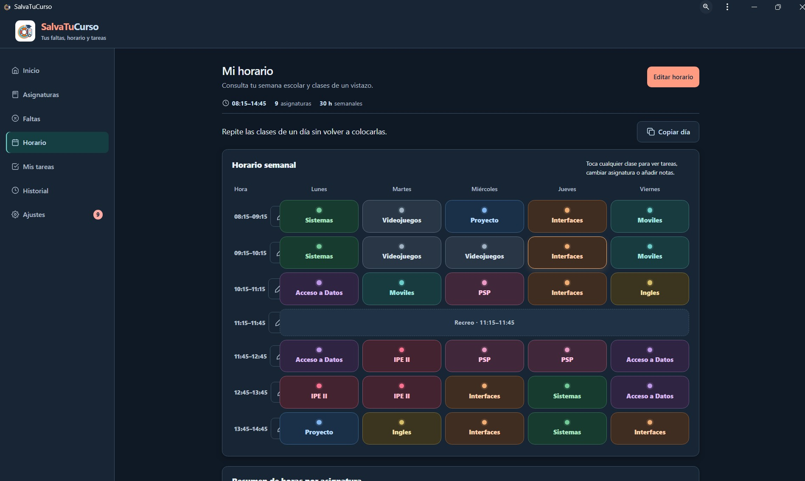
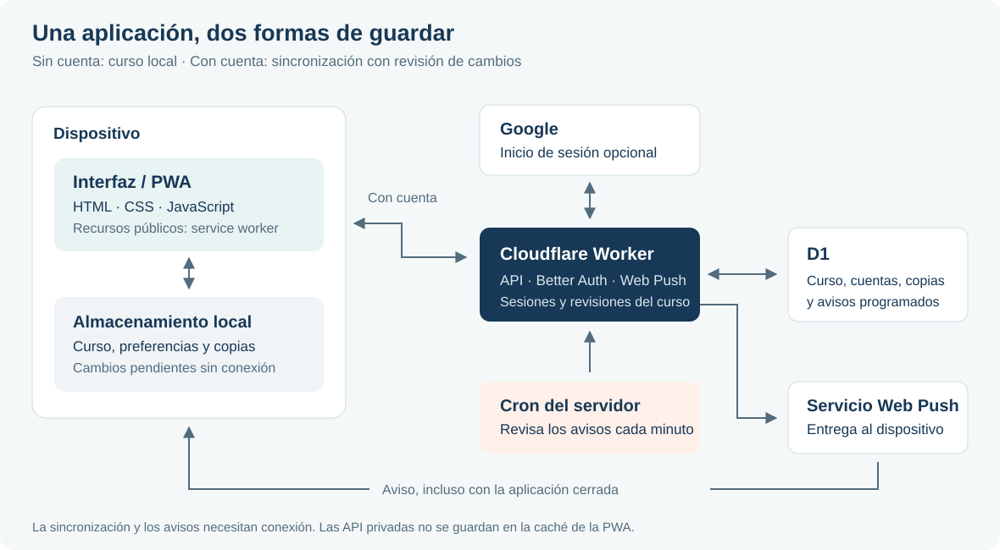

<p align="center">
  
</p>

<h1 align="center">SalvaTuCurso</h1>

<p align="center">Tus faltas, horario y tareas en un solo lugar.</p>

<p align="center">
  <a href="https://salvatucurso.qirris.workers.dev"><strong>Abrir la aplicación</strong></a>
  · <a href="docs/caso-de-estudio.md">Origen y desarrollo</a>
  · <a href="docs/guia-de-uso.md">Guía de uso</a>
</p>

SalvaTuCurso es una aplicación web instalable para organizar el curso y llevar un registro de ausencias. Reúne horario, asignaturas, exámenes y tareas, con cálculos orientativos de asistencia adaptados a ESO, Bachillerato y Formación Profesional presencial en Andalucía.



## Por qué creé SalvaTuCurso

La idea surgió un día en clase, al escuchar a mis compañeros discutir cuánto podían faltar antes de perder la evaluación continua. Me puse a investigar la normativa y no encontré una herramienta que me sirviera para reunir las reglas y llevar ese seguimiento. Decidí crearla.

Después incorporé los exámenes y las tareas: quería poder consultar las faltas y organizar el trabajo del curso desde el mismo sitio. El proyecto fue creciendo a partir de esas necesidades y de las pruebas de uso en el móvil.

## Qué permite hacer

| Asistencia | Organización | Continuidad |
| --- | --- | --- |
| Registrar faltas manuales o por clases de un día. | Consultar el horario y sus asignaturas por colores. | Usar la app sin cuenta o entrar con Google. |
| Distinguir horas estimadas y confirmadas y guardar criterios del centro. | Preparar exámenes, entregas y notas. | Sincronizar el curso con revisión de cambios. |
| Revisar el historial y recuperar borrados con Deshacer. | Configurar vacaciones y días sin clase. | Descargar copias y recibir avisos con la app cerrada. |

Las capturas de esta presentación las he tomado de la aplicación real en escritorio. Muestran el horario y los formularios de asignaturas y tareas; se han excluido las pantallas con el correo de la cuenta y las cifras de faltas. El [caso de estudio](docs/caso-de-estudio.md) incluye las otras capturas y explica las decisiones, las comprobaciones y las limitaciones actuales.

## Cómo se ha construido

La interfaz utiliza **HTML, CSS y JavaScript sin framework**. El funcionamiento instalable y sin conexión se apoya en un **service worker**. Las cuentas, el curso sincronizado y los avisos se gestionan con **Cloudflare Workers, D1, Better Auth y Web Push**.



### Mi participación y el uso de IA

Es un proyecto personal desarrollado con uso intensivo de IA, principalmente mediante ChatGPT y Codex. **Gran parte del código fue generada por la IA**, que también ayudó con las pruebas automatizadas, la documentación y la publicación.

Mi aportación ha sido detectar la necesidad, definir las funciones, decidir cómo debía comportarse la aplicación, solicitar cambios y probarla como usuario. Por ejemplo, propuse la navegación inferior en móvil, el registro de faltas desde el horario y los avisos de exámenes y tareas. También probé en mi móvil la recepción de notificaciones con la app cerrada.

El [proceso de desarrollo](docs/caso-de-estudio.md#cómo-he-trabajado-con-ia) recoge esta colaboración y distingue las pruebas personales de las comprobaciones automatizadas.

## Probarla y conservar los datos

Puedes [abrir SalvaTuCurso](https://salvatucurso.qirris.workers.dev) sin crear una cuenta. Sin sesión, el curso se guarda en ese navegador; con Google, se sincroniza con Cloudflare y mantiene una copia local. Antes de sustituir versiones distintas se pide revisarlas.

La app permite descargar e importar copias JSON y eliminar la cuenta desde Ajustes. La apariencia y los permisos de notificaciones se eligen por dispositivo. Consulta la [política de privacidad](https://salvatucurso.qirris.workers.dev/privacidad.html) y la [guía de uso](docs/guia-de-uso.md).

Para instalarla, utiliza la opción de instalación de Chrome en Android o escritorio. En iPhone, abre Safari y selecciona **Compartir → Añadir a pantalla de inicio**. La [guía de instalación](docs/guia-de-uso.md#instalar-la-aplicación) incluye los pasos y las condiciones de uso sin conexión.

## Ejecutar y comprobar el proyecto

Con Node.js y npm instalados:

```bash
npm ci --ignore-scripts
npm test
npm run build
```

Las pruebas cubren cálculos, calendario, edición del horario, faltas, migración, sincronización, aislamiento de cuentas y recordatorios. Las pruebas del servidor utilizan servicios locales simulados, sin enviar correos ni notificaciones reales.

Para revisar la interfaz y el guardado local, sirve la carpeta con un servidor estático; por ejemplo, con Python:

```bash
python -m http.server 8080 --bind 127.0.0.1
```

Abre `http://localhost:8080`. Las cuentas y los avisos necesitan el Worker; esta ejecución estática conserva el modo local. Para desarrollar el servidor, utiliza `npm run dev` y consulta antes la [configuración de Cloudflare](docs/notificaciones.md). Las credenciales se mantienen fuera del repositorio.

## Estado y documentación

La aplicación está publicada en Cloudflare y permite acceso con Google. El registro con correo y contraseña está aplazado. Entre las comprobaciones pendientes están la continuidad de un mismo curso en dos dispositivos y la instalación y el funcionamiento sin conexión en distintos dispositivos físicos.

- [Caso de estudio: origen, decisiones y desarrollo](docs/caso-de-estudio.md).
- [Guía de uso e instalación](docs/guia-de-uso.md).
- [Cuentas, sincronización, avisos y publicación](docs/notificaciones.md).
- [Comprobaciones pendientes](instrucciones/TAREAS_PENDIENTES.md).
- [Referencias sobre evaluación continua en Andalucía](docs/referencia-normativa-evaluacion-continua-andalucia.txt).

Los indicadores de asistencia son orientativos y no determinan si apruebas o suspendes. La aplicación distingue las estimaciones de los datos confirmados por la persona y remite a los criterios del centro. Cloudflare es la única web publicada; GitHub Pages está desactivado.

