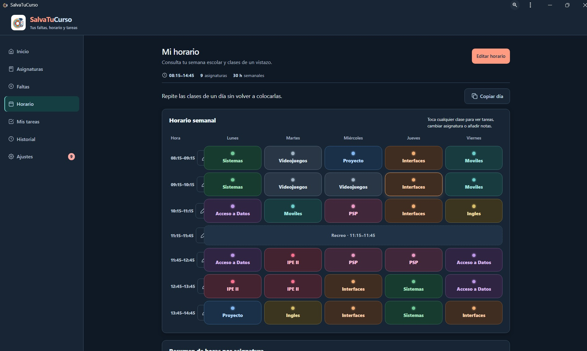
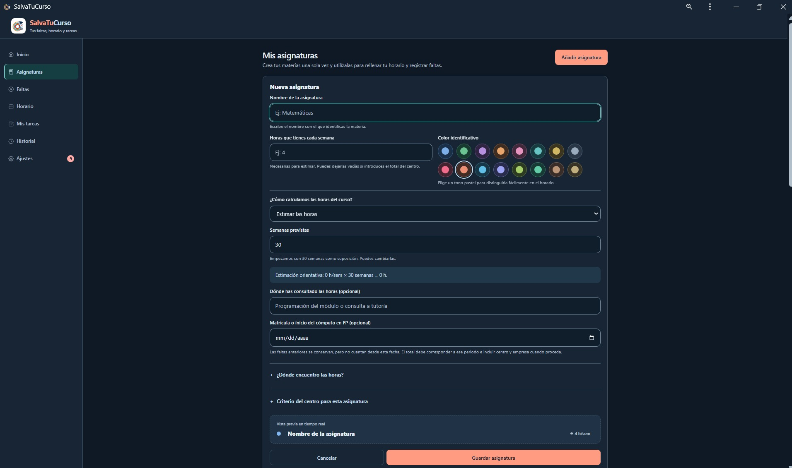
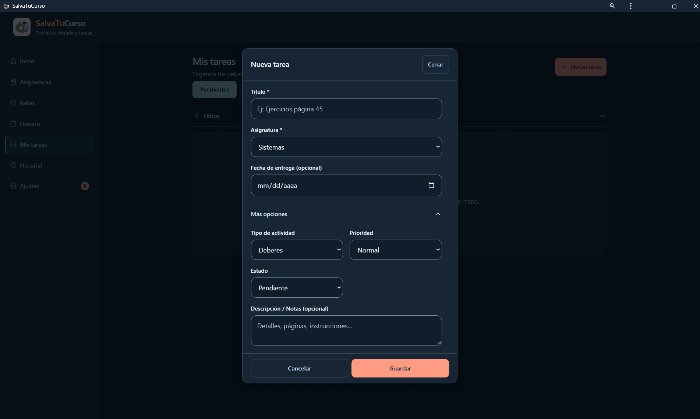
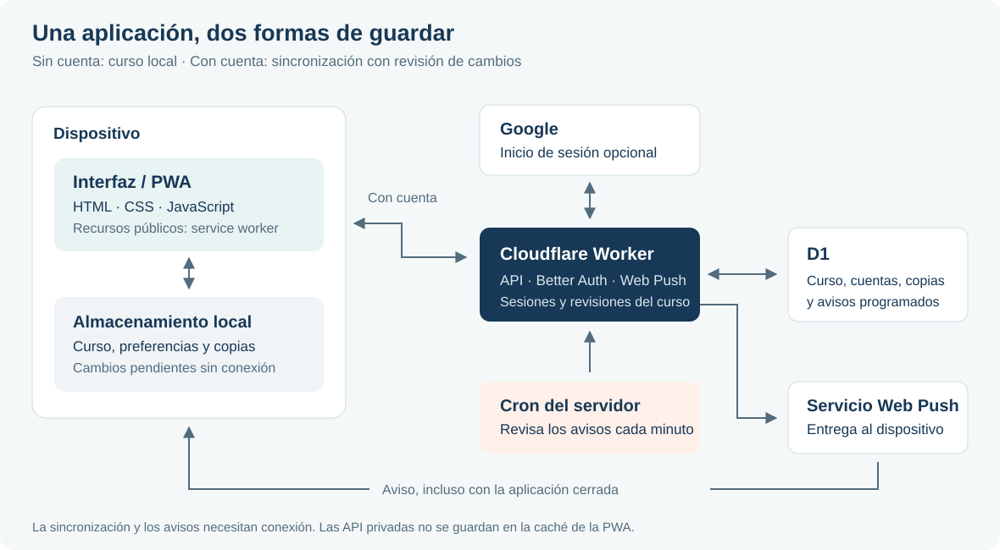

# SalvaTuCurso: de una conversación en clase a una aplicación publicada

[Abrir la aplicación](https://salvatucurso.qirris.workers.dev) · [Volver al repositorio](../README.md) · [Guía de uso](guia-de-uso.md)

SalvaTuCurso nació para responder a una pregunta que escuché en clase: **¿cuánto se puede faltar antes de perder la evaluación continua?** A partir de esa necesidad fui definiendo una aplicación para llevar las ausencias y organizar el curso. El desarrollo se realizó con uso intensivo de IA; aquí explico mi participación, las decisiones del proyecto y qué se ha comprobado.

## El problema que quería resolver

Un día escuché a mis compañeros debatir cuántas faltas podían acumular. Me puse a investigar y comprobé que, para interpretar ese dato, había que tener en cuenta la enseñanza, las horas del módulo o materia y las reglas del centro. No encontré una herramienta que respondiera a lo que necesitaba y decidí crearla.

La primera idea era registrar las faltas y consultar su relación con las horas previstas. Después añadí horario, exámenes y tareas para que el seguimiento de ausencias formara parte de la organización diaria del curso.

El producto está pensado para estudiantes de ESO, Bachillerato y Formación Profesional presencial en Andalucía. Ayuda a registrar y entender los datos; el centro sigue siendo quien determina y comunica la aplicación de sus criterios de evaluación.

## Cómo fue creciendo la idea

| Etapa | Necesidad | Respuesta incorporada |
| --- | --- | --- |
| Registro de ausencias | Llevar la cuenta por materia o módulo. | Asignaturas, faltas y resumen de horas. |
| Organización del curso | Consultar clases, entregas y exámenes en un mismo sitio. | Horario editable, calendario, tareas y notas. |
| Uso desde el móvil | Acceder con comodidad a las funciones habituales. | Navegación inferior, horario por días y temas claro y oscuro. |
| Menos trabajo repetido | Registrar una jornada perdida sin introducir cada falta a mano. | Selección de clases de un día, duración calculada y revisión de coincidencias. |
| Continuidad entre dispositivos | Conservar el curso y recibir avisos. | Google, sincronización, copias y notificaciones programadas. |
| Revisión de los cálculos | Diferenciar una estimación de la información del centro. | Horas estimadas o confirmadas, criterios documentados y datos pendientes. |

## El producto actual

Inicio reúne la próxima clase, la entrega más cercana y un resumen de ausencias. El horario identifica cada asignatura por su color; las actividades pueden vincularse a una clase y seguir conservándose aunque esa clase cambie.

*Captura de la aplicación instalada en el ordenador, aportada por mí para esta presentación.*

En el móvil se priorizan Inicio, Mis tareas, Horario, Faltas y Más. Los temas claro y oscuro adaptan tanto la interfaz como los colores de las asignaturas.

El formulario de asignaturas permite elegir uno de los 16 colores, estimar las horas o introducir el total del centro, y guardar la procedencia de la información. Las opciones adicionales permiten documentar un criterio específico.

Crear una tarea empieza por título, asignatura y fecha. En **Más opciones** se puede indicar tipo, prioridad, estado y notas.

*Estas imágenes proceden de mis capturas de la aplicación real en escritorio. Se han seleccionado el horario y los formularios sin completar, dejando fuera la pantalla de cuenta con el correo y la de Inicio con las cifras de faltas. No se presentan como datos ficticios ni como una comprobación de la vista móvil.*

## Cómo he trabajado con IA

La idea y la dirección funcional del producto son mías. El desarrollo contó con una intervención amplia de herramientas de IA, principalmente ChatGPT y Codex. **Gran parte del código fue generada por la IA**, que también ayudó con el diseño de pruebas, la documentación, la investigación de fuentes y la publicación.

Mi trabajo consistió en describir la necesidad, proponer funciones, elegir comportamientos y revisar la experiencia como usuario. Por ejemplo:

- Pedí una navegación inferior para el móvil y una sección Más para las opciones menos frecuentes.
- Propuse registrar las faltas de un día desde las clases del horario.
- Solicité avisos de exámenes y tareas con la app cerrada, y probé su recepción en mi móvil.
- Preferí permitir estimaciones cuando no se conocen las horas oficiales, con un aviso visible para revisarlas después.

El proceso fue iterativo: plantear una necesidad, concretar el comportamiento, implementar con IA, comprobar y solicitar ajustes. Las pruebas automatizadas y gran parte del trabajo técnico se ejecutaron con ayuda de la IA. Mis pruebas personales de uso se distinguen de esas verificaciones.

## Arquitectura y decisiones técnicas

| Decisión | Motivo y consecuencia |
| --- | --- |
| HTML, CSS y JavaScript sin framework en la interfaz | Mantener una estructura de módulos centrada en las vistas y funciones del producto. El servidor sí utiliza dependencias como Better Auth y Web Push. |
| PWA con service worker | Permitir instalar la aplicación y conservar recursos públicos para el uso sin conexión. El inicio de sesión y la sincronización necesitan internet. |
| Curso local y acceso opcional con Google | Permitir empezar sin una cuenta y añadir sincronización cuando se necesita. Los datos de invitado y de cuenta tienen almacenamiento separado. |
| Cloudflare Workers y D1 | Servir interfaz y API desde el mismo origen y guardar el curso, las sesiones, las copias y los avisos del servidor. |
| Notificaciones programadas en el servidor | Evitar depender de un temporizador de una pestaña abierta. La recepción sigue condicionada por el navegador, los permisos y el dispositivo. |

La [documentación de Cloudflare](notificaciones.md) recoge la configuración y las condiciones de publicación. Las API privadas quedan fuera de la caché de la PWA y las credenciales no forman parte de los recursos públicos.

## Tres retos del desarrollo

### Sincronizar sin sustituir cambios a ciegas

Compartir datos entre móvil y ordenador introduce la posibilidad de que ambos dispositivos editen una versión diferente. El curso lleva una revisión: si el servidor ya tiene otra, se solicita revisar las versiones antes de sustituir una por otra. Las listas no se mezclan automáticamente y se conservan copias.

Este comportamiento está cubierto por pruebas locales de concurrencia y aislamiento de cuentas. Sigue pendiente comprobar con un curso real la continuidad completa entre dos dispositivos físicos.

### Cambiar el formato sin perder el curso

La incorporación de horas estimadas y confirmadas requirió ampliar el formato académico. La versión 3 ofrece descargar una copia antes de continuar, mantiene el almacenamiento anterior y conserva los totales existentes como pendientes de confirmar.

El nuevo formato utiliza un espacio de almacenamiento propio y el servidor exige identificar la versión del cliente antes de permitir el acceso al curso. Así se evita que una edición antigua sustituya los campos nuevos al sincronizar. Las pruebas cubren formatos incompletos, fallos de guardado y conservación de registros.

### Mostrar cálculos con el alcance adecuado

Una multiplicación de horas semanales por semanas es una estimación, no necesariamente la duración oficial de un módulo. La aplicación permite mantener esa estimación o introducir un total confirmado por la persona, y separa el mínimo de asistencia de FP del criterio documentado del centro.

Los porcentajes muestran ausencias sobre el total previsto. Las faltas anteriores al inicio del cómputo pueden excluirse del cálculo sin borrarse del historial. Los mensajes remiten al centro para interpretar sus consecuencias; no declaran aprobado, suspendido ni una pérdida oficial del derecho a evaluación continua.

Las [referencias educativas](referencia-normativa-evaluacion-continua-andalucia.txt) y la [guía de uso](guia-de-uso.md#horas-estimadas-horas-del-centro-y-criterios) explican ese alcance. La aplicación se presenta como herramienta informativa, sin atribuirle una certificación de cumplimiento normativo completo.

## Qué se ha comprobado

**Pruebas automatizadas.** El repositorio incluye pruebas de cálculos y umbrales, fechas y vacaciones, edición de clases, registro por jornadas, recuperación de borrados, migración, temas, recursos sin conexión, sincronización, aislamiento de cuentas y recordatorios. El backend se prueba con SQLite y transportes simulados; esos ensayos no envían mensajes reales.

**Formularios.** Se ha probado el arranque y distintas operaciones sobre el HTML real en un DOM simulado: alta estimada, edición confirmada, criterios, cancelación, faltas de empresa y migración. Son comprobaciones distintas de las pruebas en navegadores y dispositivos físicos.

**Uso personal en móvil.** Probé la recepción de una notificación inmediata y de otra programada mientras la aplicación estaba cerrada. Esa recepción verifica el recorrido probado, sin garantizar que el sistema operativo entregue siempre los avisos sin retrasos.

**Publicación.** La aplicación está disponible en Cloudflare. GitHub conserva el código, la documentación y el historial. Esta presentación utiliza capturas reales de escritorio que he aportado; documentarla no ha requerido modificar el curso de producción.

## Limitaciones y próximos pasos

- Confirmar con un curso real que los mismos contenidos aparecen en móvil y ordenador.
- Ampliar las pruebas de instalación y funcionamiento sin conexión en dispositivos físicos y revisar el icono maskable.
- Completar la revisión visual y de accesibilidad de los formularios recientes en todos los tamaños previstos. Las capturas cubren vistas concretas, no una auditoría completa.
- Mantener como revisión manual las reglas por trimestres, sesiones u otras condiciones que no pueden representarse con un umbral de curso completo.
- Conservar el correo y contraseña como función aplazada; Google es el acceso remoto disponible.

El seguimiento detallado está en [Tareas pendientes](../instrucciones/TAREAS_PENDIENTES.md). No se publican cifras de usuarios, mejoras de rendimiento o métricas de impacto que no se hayan medido.

## Qué me llevo del proyecto

La evolución del producto me ha llevado a concretar peticiones: qué debe conservarse al cambiar una clase, cuándo pedir revisar dos versiones y cómo distinguir datos conocidos de estimaciones. También me ha permitido comprobar que una función necesita algo más que aparecer en pantalla: guardado, errores, recuperación y pruebas de uso.

He utilizado la IA para convertir esas decisiones en una aplicación y para explorar su implementación. El resultado y sus límites quedan documentados en el repositorio para que se puedan revisar junto con el código.
